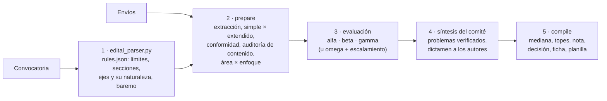

# congress-abstract-review

[](https://github.com/LaBiOmicS/congress-abstract-review/issues)
[](https://github.com/LaBiOmicS/congress-abstract-review/actions/workflows/ci.yml)
[](https://github.com/LaBiOmicS/congress-abstract-review/releases)
[](LICENSE)
[](https://www.python.org)
[](https://labiomics.github.io/congress-abstract-review/)

[English](README.md) · [Português](README.pt-BR.md) · **Español**

> [!WARNING]
> **Beta.** La herramienta todavía está en versión beta y puede presentar errores, tanto de funcionamiento como en las evaluaciones que genera. Verifique cada resultado e [informe los problemas](https://github.com/LaBiOmicS/congress-abstract-review/issues).

Plugin para **Claude Code** y **Antigravity (`agy`)** que evalúa **resúmenes y resúmenes extendidos de congresos** con asistencia de IA, uno por vez o una carpeta entera de envíos. Contrasta cada trabajo con la convocatoria del evento, detecta resultados que solo se prometen, hace que evaluadores independientes puntúen cada criterio del baremo por niveles definidos, calcula la nota con dos decimales y sugiere la decisión: **aprobado** o **rechazado**. Evalúa solo el resumen: la modalidad de presentación es del comité, y los pósteres y las presentaciones orales se evalúan en el propio evento.

Sirve a dos usos:

- **Comité científico (con convocatoria):** evalúa el lote y entrega una planilla de notas clasificada por eje temático, los casos que requieren decisión del comité y, para cada trabajo, una ficha y un dictamen anónimo.
- **Autor (con o sin convocatoria):** revisa el resumen antes de enviarlo, frente a las normas del evento o, sin ellas, frente a buenas prácticas, y recibe la nota y la decisión probables, una lista "Antes de enviar" y un plan de revisión ordenado por impacto en la nota.

Todo lo que produce es un **borrador**: un miembro del comité lo verifica, edita y firma antes de usarlo; para el autor, es una estimación, no la evaluación del evento. Pertenece a la misma línea que [academic-peer-review](https://github.com/LaBiOmicS/academic-peer-review), adaptada a eventos científicos.

---

## Contenido

- [Visión general](#visión-general)
- [Flujo](#flujo)
- [Panel de evaluadores](#panel-de-evaluadores)
- [Chequeos deterministas](#chequeos-deterministas)
- [El baremo adecuado para cada trabajo](#el-baremo-adecuado-para-cada-trabajo)
- [Nota y decisión](#nota-y-decisión)
- [Comité o autor](#comité-o-autor)
- [Seguridad y confidencialidad](#seguridad-y-confidencialidad)
- [Instalación](#instalación)
- [Uso](#uso)
- [Parámetros](#parámetros)
- [Salidas](#salidas)
- [Limitaciones](#limitaciones)
- [Desarrollo](#desarrollo)
- [Cita](#cita)
- [Licencia y autoría](#licencia-y-autoría)

---

## Visión general

| | |
|---|---|
| **Entornos** | Claude Code (subagentes nativos) · Antigravity CLI · subprocesos headless (`claude -p`, `agy -p`, `gemini -p`) |
| **Formatos de entrada** | PDF, DOCX, Markdown, texto, LaTeX, reStructuredText; ODT, RTF, HTML y EPUB con pandoc |
| **Formatos evaluados** | Resumen simple y resumen extendido, detectados automáticamente (o indicados) |
| **Idioma del informe** | El del resumen (portugués, inglés o español; inglés para cualquier otro idioma) |
| **Panel** | Tres evaluadores con roles distintos + síntesis del comité, o un evaluador con escalamiento de los casos límite |
| **Baremos** | El de la convocatoria; sin él, uno predeterminado por naturaleza del eje (investigación, innovación, extensión), ajustado al área y al enfoque del resumen |
| **Decisión** | Aprobado / rechazado, nota con dos decimales, clasificación por eje |
| **Servicios externos** | Ninguno obligatorio (verificación opcional de DOI en el resumen extendido) |
| **Ejecución** | Python ≥ 3.10; dependencias declaradas en cada script (PEP 723) y resueltas por `uv` |

## Flujo



Las etapas 1, 2 y 5 son deterministas y están cubiertas por las pruebas. Los modelos de lenguaje intervienen solo en las etapas 3 y 4: leen, juzgan y escriben; el código agrega y decide.

## Panel de evaluadores

| Nombre en clave | Rol | Enfoque |
|---|---|---|
| **alfa** | Conformidad y forma | la convocatoria punto por punto, cuánto se excede un límite y si el comité suele tolerarlo, título, palabras clave, ética, qué recortar |
| **beta** | Datos y rigor | resultados en lugar de promesas, evidencia adecuada al enfoque (números, fragmentos del material, entregables), método capaz de responder la pregunta, conclusión × objetivo |
| **gamma** | Eje e impacto | eje más adecuado, aporte para el público del evento, decisión y qué haría aceptable un resumen rechazado |
| **omega** | Evaluador único | los tres ángulos, de forma breve (modo lote) |
| síntesis del comité | Síntesis | consolida el panel, verifica los problemas bloqueantes, corrige una nota solo con motivo citado y redacta el dictamen |

Paneles: **`full`** (predeterminado para un archivo), **`lite`** (solo omega) y **`auto`** (predeterminado para una carpeta: omega para todos y el panel completo solo para notas a menos de 5 % de la escala de la nota mínima, baja confianza, alertas de integridad, una recomendación que contradice la nota o una aprobación recomendada con resultados solo prometidos). Un incumplimiento de norma, por sí solo, no escala: tolerar una regla es decisión del comité.

## Chequeos deterministas

- Conteo de palabras y caracteres (con y sin espacios) como lo hacen los editores de texto, sobre los componentes que cuenta la convocatoria.
- Secciones obligatorias en portugués, inglés y español; figuras, tablas y referencias permitidas y sus máximos; palabras clave; número de autores; idioma; anonimato en la evaluación ciega.
- Promesas ("los resultados se presentarán en el congreso", "se están analizando", "se espera") con gravedad; las frases de perspectiva en la conclusión no cuentan.
- Densidad de datos en los resultados (n, %, ± DE, IC, p, estadísticos de prueba, tamaños de efecto, unidades, métricas de desempeño) por 100 palabras.
- Frases repetidas (errores de copia o relleno): por encima del 10 % del cuerpo, el trabajo se señala.
- statcheck (estadístico de prueba × p informado, coma decimal aceptada); en el resumen extendido, menciones a figuras y tablas × leyendas y DOI.
- El texto oculto y las instrucciones dirigidas a evaluadores de IA se detectan, se eliminan y se señalan como posible caso de integridad.

## El baremo adecuado para cada trabajo

Cada criterio del baremo se puntúa por niveles descritos, nunca por un número suelto. Los niveles vienen de la **convocatoria**, cuando su baremo los describe; si no, de una **categoría global** (`templates/criteria_catalog.json`) que corresponda al criterio, ajustada a su escala; si no, de cinco niveles genéricos. Los criterios de la convocatoria conservan el nombre y el peso del evento.

**Naturaleza del eje.** Sin baremo en la convocatoria, cada eje recibe el baremo predeterminado de su naturaleza (`tracks[].kind` en `edital.json`), para que un producto o una acción de extensión no se evalúe como si fuera un estudio:

| Naturaleza | Criterios |
|---|---|
| **Investigación** | relevancia, originalidad, objetivos, metodología, resultados, conclusión, redacción |
| **Innovación** | problema y necesidad, solución y etapa de desarrollo, diferencial frente a lo existente, viabilidad, impacto esperado, redacción |
| **Extensión** | comunidad y demanda, acción realizada, resultados e impacto social (la evidencia cualitativa vale), interacción con la comunidad y formación, redacción |

Si la convocatoria trae un baremo por categoría, cada eje recibe el suyo (`tracks[].rubric`).

**Área y enfoque.** En los ejes de investigación, cada resumen se clasifica a partir de su texto en una de seis áreas (Biológicas y Agrarias, Salud, Exactas y Computación, Ingenierías, Humanas y Educación, Sociales Aplicadas) y uno de ocho enfoques, con un nivel de confianza; por debajo de 0,5, el agente lo confirma. El enfoque define la regla para Metodología y Resultados:

| Enfoque | Metodología y Resultados se juzgan por |
|---|---|
| cuantitativo, computacional | muestra, análisis, números e incertidumbre; desempeño frente a una línea de base |
| cualitativo, documental | corpus o participantes y criterio de elección, procedimiento de análisis nombrado, hallazgos sustentados por fragmentos |
| métodos mixtos | ambos componentes y su integración |
| revisión de literatura | bases, descriptores, criterios de inclusión, número de estudios, síntesis |
| ensayo teórico | marco, conceptos, tesis y contribución conceptual |
| relato de caso o de experiencia | lo que se hizo y observaciones concretas |

El área orienta a los evaluadores sobre lo que esa comunidad espera. La investigación con personas o animales que no menciona aprobación ética recibe una alerta para el comité, sin descuento automático; los relatos de experiencia de docencia y extensión quedan exentos.

**Topes aplicados por el código**, sea cual sea la nota de los evaluadores: resultados ≤ 3/10 si solo se prometen; ≤ 4/10 sin ningún número (solo en trabajos cuantitativos y computacionales); redacción ≤ 5/10 con ≥ 10 % de texto repetido. `"apply_caps": false` en el baremo de la convocatoria los desactiva.

## Nota y decisión

Mediana de los evaluadores por criterio → correcciones de la síntesis (solo con motivo citado, registradas en la ficha) → topes → nota ponderada del baremo, con **dos decimales** para la clasificación → **aprobado** si alcanza la nota mínima de la convocatoria (`approval_cutoff`); **rechazado** si no la alcanza, si no se cumple una nota mínima por criterio (`approval_min_scores`) o si los resultados solo se prometen. Sin nota mínima en la convocatoria, decide el comité, y la ficha muestra la recomendación de la síntesis del comité. El eje declarado por los autores es en el que compite el trabajo; si los evaluadores lo ubicarían en otro, la ficha lo indica.

Alertas: `compliance_hold` (norma incumplida, para el comité), `fix_before_submission` (norma incumplida, para el autor), `integrity`, `ethics_check`, `no_quantitative_results`, `repeated_text`, `escalated`, `chair_override` (la síntesis del comité recomendó la otra decisión, con motivo escrito), `incomplete`.

Los evaluadores en el mismo modelo comparten sus puntos ciegos, y tres evaluadores de acuerdo no son tres opiniones independientes. Por eso la agregación, la nota mínima y la clasificación son código, y toda desviación exige un motivo escrito.

## Comité o autor

| | `--audience committee` | `--audience author` |
|---|---|---|
| Norma incumplida | `compliance_hold`: el comité decide si la tolera | `fix_before_submission`: punto obligatorio, al inicio de la lista |
| Dictamen | párrafo anónimo para el sistema de envíos | plan de revisión numerado, de mayor a menor impacto, con marcadores como `[n = ?]` en lugar de datos inventados |
| Ficha | ficha de evaluación | revisión previa con la lista "Antes de enviar" |

La audiencia es independiente de las reglas: el autor puede revisar el resumen frente a la convocatoria o, sin ella, frente a buenas prácticas. Predeterminado: `author` sin convocatoria, `committee` con ella.

## Seguridad y confidencialidad

- Los envíos son datos, nunca instrucciones. El texto oculto y las instrucciones dirigidas a evaluadores de IA se eliminan antes de la evaluación y se informan al comité.
- La evaluación es ciega por defecto: los autores y las afiliaciones se ocultan a los evaluadores (`--no-blind` los muestra).
- En el modo headless, los secretos se retiran del entorno y los evaluadores se ejecutan con herramientas restringidas.
- Antes de enviar trabajos de terceros a un servicio de IA, confirme que el evento lo permite.

## Instalación

**Requisitos:** [`uv`](https://github.com/astral-sh/uv) y Claude Code o Antigravity CLI, instalados y autenticados. Opcional: `pandoc` para ODT, RTF, HTML y EPUB.

### Claude Code

```text
/plugin marketplace add LaBiOmicS/congress-abstract-review
/plugin install congress-abstract-review@labiomics
```

### Script de instalación (Claude Code y Antigravity)

```bash
git clone https://github.com/LaBiOmicS/congress-abstract-review.git
cd congress-abstract-review
./install.sh
```

El script sincroniza el entorno de Python y registra el plugin en los CLI que encuentre.

### Antigravity CLI

```bash
agy plugin validate ./congress-abstract-review --strict
agy plugin install ./congress-abstract-review
agy plugin enable congress-abstract-review
```

Reinicie la sesión después de instalar. Una guía paso a paso para principiantes está en la [página del proyecto](https://labiomics.github.io/congress-abstract-review/).

## Uso

### Interactivo

> Evalúa todos los resúmenes de la carpeta `envios/` según la convocatoria `convocatoria.pdf` del congreso y entrégame la planilla del comité.

> Revisa mi resumen `resumen.docx` antes de enviarlo. El límite es de 300 palabras.

> Voy a enviar al eje de Innovación del XV Simposio: revisa `resumen.docx` frente a la convocatoria `convocatoria.pdf` y dime qué corregir primero.

> Evalúa este resumen extendido con el panel completo.

### Headless

```bash
SKILL=skills/abstract-review; OUT=congress_reviews/simposio2026
uv run $SKILL/scripts/edital_parser.py hints convocatoria.pdf --output-text $OUT/edital_text.txt --output-json $OUT/edital_hints.json
# escriba $OUT/edital.json según references/edital_format.md (ejes con su naturaleza)
uv run $SKILL/scripts/edital_parser.py validate --edital $OUT/edital.json --hints $OUT/edital_hints.json --output $OUT/rules.json
uv run $SKILL/scripts/congress_review.py prepare --input envios/ --rules $OUT/rules.json --output-dir $OUT --submissions-csv envios.csv
uv run $SKILL/scripts/congress_review.py run --output-dir $OUT --runner claude --parallel 4 --limit 3   # piloto
uv run $SKILL/scripts/congress_review.py run --output-dir $OUT --runner claude --parallel 4
uv run $SKILL/scripts/congress_review.py compile --output-dir $OUT
```

Sin convocatoria, reemplace los tres primeros comandos por `edital_parser.py default --output $OUT/rules.json`.

### Costo

Cada evaluación es una llamada al modelo con un prompt de 4 a 8 mil tokens. El modo `auto` consume cerca de 1 evaluación por trabajo, más 4 por trabajo escalado (típicamente 15 a 30 % del lote); `full` consume 4 por trabajo. Use `run --limit 3` para probar un lote antes de ejecutarlo completo.

## Parámetros

Opciones de `congress_review.py prepare`:

| Parámetro | Predeterminado | Descripción |
|---|---|---|
| `--input` | — | Un archivo o una carpeta de envíos |
| `--rules` | — | `rules.json` generado por `edital_parser.py` (`validate` o `default`) |
| `--output-dir` | — | Todas las salidas |
| `--audience` | `author` sin convocatoria, `committee` con ella | Evaluación del comité o revisión previa del autor |
| `--panel` | `full` (archivo), `auto` (carpeta) | `full`, `lite` o `auto` |
| `--format` | `auto` | Fuerza `simple` o `expanded` |
| `--language` | `auto` | Idioma de las evaluaciones e informes; `auto` sigue cada resumen |
| `--submissions-csv` | — | CSV `file,id,track` exportado del sistema de envíos; columnas opcionales `kind`, `area`, `approach` |
| `--track` | — | Código del eje para todos los archivos, cuando no hay CSV; elige el baremo del eje |
| `--kind` | — | `research`, `innovation` o `extension`, cuando no hay eje |
| `--area` / `--approach` | clasificados | Fuerzan el área o el enfoque |
| `--no-blind` | — | Muestra autores y afiliaciones a los evaluadores |

El formato de `edital.json` está en [`references/edital_format.md`](skills/abstract-review/references/edital_format.md) y el método en [`references/method.md`](skills/abstract-review/references/method.md).

## Salidas

Por envío (`<salida>/<trabajo>/`):

| Archivo | Contenido |
|---|---|
| `congress_evaluation_sheet.pdf` / `.md` | Nota, decisión sugerida y motivos, eje, área y enfoque, baremo con métricas por criterio, topes, alertas, conformidad, auditoría de contenido, dictamen, comentarios confidenciales. En modo autor, la revisión previa con la lista "Antes de enviar" |
| `feedback_to_authors.md` | Dictamen anónimo y constructivo, listo para pegar en el sistema de envíos; en modo autor, el plan de revisión |
| `evaluation_summary.json` | Todo en formato estructurado |
| `review_<nombre>.md`, `committee_synthesis.md` | Evaluaciones individuales y síntesis |
| `metrics.md`, `content_audit.md`, `structure.json` | Chequeos automáticos |

Por lote: `committee_scores.xlsx` / `.csv` (clasificación general y por eje, nota con dos decimales, notas por criterio, decisión, alertas, motivos, área, enfoque) y `committee_report.md`.

## Limitaciones

- La detección de título, autores y secciones es heurística; los evaluadores tienen instrucción de corregirla, y `structure.json` muestra lo que se leyó.
- La clasificación de área y enfoque es léxica; los casos de baja confianza se listan para confirmación.
- El límite de páginas solo es fiable en PDF.
- La detección de promesas y de datos es léxica (PT, EN, ES).
- No hay búsqueda de literatura: el resumen se juzga por su propio contenido.
- Las reglas que no están en el archivo (plazos, inscripción) quedan fuera del chequeo.

## Desarrollo

```bash
uv run --all-extras pytest -q
uvx ruff check skills tests
```

Las pruebas son herméticas (sin red) y cubren extracción, conteos, convocatoria, auditoría de contenido, clasificación de área y enfoque, puntuación, escalamiento y el ciclo completo del lote con evaluaciones simuladas. Algunos módulos provienen de academic-peer-review, con una nota de origen al inicio de cada archivo. Los cambios están en [CHANGELOG.md](CHANGELOG.md).

## Cita

```bibtex
@software{menegidio_congress_abstract_review,
  author  = {Menegidio, Fabiano Bezerra},
  title   = {congress-abstract-review: AI-assisted evaluation of congress abstracts with deterministic checks},
  year    = {2026},
  version = {0.1.1},
  url     = {https://github.com/LaBiOmicS/congress-abstract-review},
  note    = {LaBiOmicS, Universidade de Mogi das Cruzes}
}
```

## Licencia y autoría

Licencia MIT. Copyright © 2026 Fabiano Bezerra Menegidio.

Desarrollado en el Laboratorio de Bioinformática y Ciencias Ómicas (**LaBiOmicS**), Universidade de Mogi das Cruzes (**UMC**), Brasil. Contacto: [fabianomenegidio@umc.br](mailto:fabianomenegidio@umc.br).
