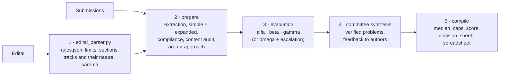

# congress-abstract-review

[](https://github.com/LaBiOmicS/congress-abstract-review/issues)
[](https://github.com/LaBiOmicS/congress-abstract-review/actions/workflows/ci.yml)
[](https://github.com/LaBiOmicS/congress-abstract-review/releases)
[](LICENSE)
[](https://www.python.org)
[](https://labiomics.github.io/congress-abstract-review/)

**English** · [Português](README.pt-BR.md) · [Español](README.es.md)

> [!WARNING]
> **Beta.** The tool is still in beta and may contain errors, both in how it runs and in the evaluations it produces. Check every result and [report problems](https://github.com/LaBiOmicS/congress-abstract-review/issues).

A plugin for **Claude Code** and **Antigravity (`agy`)** that evaluates **congress abstracts and expanded abstracts** with AI assistance, one at a time or a whole folder of submissions. It checks each submission against the event's call for papers (edital), detects results that are only promised, has independent evaluators score every rubric (barema) criterion against defined levels, computes the score with two decimals and suggests a decision: **approved** or **rejected**. It evaluates the abstract only: the presentation modality is the committee's, and posters and talks are judged at the event.

It serves two uses:

- **Scientific committee (with an edital):** evaluates the batch and delivers a score spreadsheet ranked by thematic track, the cases that need a committee decision, and a sheet and anonymous feedback for each submission.
- **Author (with or without an edital):** checks an abstract before submission against the event's rules or, without them, best practices, and gets the likely score and decision, a "before submitting" checklist and a revision plan ordered by impact.

Everything it produces is a **draft**: a committee member checks, edits and signs it before use; for authors it is an estimate, not the event's evaluation. It belongs to the same line as [academic-peer-review](https://github.com/LaBiOmicS/academic-peer-review), adapted to scientific events.

---

## Contents

- [Overview](#overview)
- [Pipeline](#pipeline)
- [Evaluator panel](#evaluator-panel)
- [Deterministic checks](#deterministic-checks)
- [The right barema for each work](#the-right-barema-for-each-work)
- [Score and decision](#score-and-decision)
- [Committee or author](#committee-or-author)
- [Security and confidentiality](#security-and-confidentiality)
- [Installation](#installation)
- [Usage](#usage)
- [Parameters](#parameters)
- [Outputs](#outputs)
- [Limitations](#limitations)
- [Development](#development)
- [Citation](#citation)
- [License and authorship](#license-and-authorship)

---

## Overview

| | |
|---|---|
| **Hosts** | Claude Code (native subagents) · Antigravity CLI · headless subprocesses (`claude -p`, `agy -p`, `gemini -p`) |
| **Input formats** | PDF, DOCX, Markdown, plain text, LaTeX, reStructuredText; ODT, RTF, HTML and EPUB through pandoc |
| **Formats evaluated** | Simple abstract and expanded abstract, detected automatically (or forced) |
| **Report language** | Same as the abstract (Portuguese, English or Spanish; English for any other language) |
| **Panel** | Three evaluators with distinct roles + committee synthesis, or one evaluator with escalation of borderline cases |
| **Baremas** | The edital's; otherwise a default per track nature (research, innovation, extension), adapted to the abstract's area and research approach |
| **Decision** | Approved / rejected, score with two decimals, ranking per track |
| **External services** | None required (optional DOI check for expanded abstracts) |
| **Runtime** | Python ≥ 3.10; dependencies declared inline (PEP 723) and resolved by `uv` |

## Pipeline



Steps 1, 2 and 5 are deterministic and covered by the test suite. Language models are used only in steps 3 and 4: they read, judge and write; code aggregates and decides.

## Evaluator panel

| Codename | Role | Focus |
|---|---|---|
| **alfa** | Compliance & form | edital line by line, how far over a limit and whether committees usually waive it, title, keywords, ethics, what to cut to fit |
| **beta** | Data & rigor | results instead of promises, evidence suited to the approach (numbers, excerpts from the material, deliverables), method able to answer the question, conclusion vs objective |
| **gamma** | Track & impact | best-fitting track, contribution for the event's audience, decision and what would make a rejected abstract acceptable |
| **omega** | Single evaluator | the three angles, briefly (batch mode) |
| committee synthesis | Synthesis | consolidates the panel, verifies blocking problems, corrects a score only with a quoted reason, writes the feedback to authors |

Panels: **`full`** (default for one file), **`lite`** (omega only) and **`auto`** (default for a folder: omega for every submission, the full panel only for borderline scores within 5 % of the scale from the minimum score, low confidence, integrity flags, a recommendation that contradicts the score, or approval recommended with results only promised). Rule breaches alone do not escalate: waiving a rule is the committee's call.

## Deterministic checks

- Word and character counts (with and without spaces) the way text editors count them, over the components the edital counts (body, title, authors, keywords, references, funding).
- Mandatory sections in Portuguese, English and Spanish; figures, tables and references allowed and their maxima; keywords; number of authors; language; anonymity in blind review.
- Promises ("results will be presented at the conference", "are being analyzed", "we expect") with severity; perspective sentences in the conclusion are not counted.
- Data density in the results (n, %, ± SD, CI, p, test statistics, effect sizes, units, performance metrics) per 100 words.
- Repeated sentences (copy-paste errors or padding): above 10 % of the body, the submission is flagged.
- statcheck (test statistic vs reported p, decimal commas accepted); for expanded abstracts, figure/table mentions vs captions and DOIs.
- Hidden text and instructions aimed at AI evaluators are detected, removed and flagged as a possible integrity case.

## The right barema for each work

Every barema criterion is scored against described levels, never a bare number. The levels come from the **edital** when its barema describes them; otherwise from a **global category** (`templates/criteria_catalog.json`) that matches the criterion, rescaled to its range; otherwise from five generic levels. Edital criteria keep the event's names and weights.

**Track nature.** Without a barema in the edital, each track gets the default barema of its nature (`tracks[].kind` in `edital.json`), so a product or an extension action is not scored as if it were a study:

| Nature | Criteria |
|---|---|
| **Research** | relevance, originality, objectives, methods, results, conclusion, writing |
| **Innovation** | problem and need, solution and stage of development, advantage over existing solutions, feasibility, expected impact, writing |
| **Extension** | community and demand, action carried out, outcomes and social impact (qualitative evidence counts), engagement and training, writing |

When the edital has one barema per category, each track gets its own (`tracks[].rubric`).

**Area and research approach.** In research tracks, each abstract is classified from its text into one of six areas (biological and agricultural, health, exact sciences and computing, engineering, humanities and education, applied social sciences) and eight approaches, with a confidence; below 0.5 the agent confirms it. The approach sets the ruler for methods and results:

| Approach | Methods and results judged by |
|---|---|
| quantitative, computational | sample, analysis, numbers and uncertainty; performance against a baseline |
| qualitative, documentary | corpus or participants and how they were chosen, a named analysis procedure, findings supported by excerpts |
| mixed methods | both strands and their integration |
| literature review | databases, search terms, inclusion criteria, number of studies, synthesis |
| theoretical essay | framework, concepts, thesis and conceptual contribution |
| case or experience report | what was done and concrete observations |

The area tells the evaluators what that community expects. Research with people or animals that does not mention an ethics approval (CEP/CAAE, CEUA) is flagged for the committee, never penalized automatically; experience reports of teaching and extension are exempt.

**Caps applied by code**, whatever the evaluators wrote: results ≤ 3/10 when only promised; ≤ 4/10 without any number (quantitative and computational work only); writing ≤ 5/10 with ≥ 10 % repeated text. `"apply_caps": false` in the edital's rubric turns them off.

## Score and decision

Per-criterion median of the evaluators → synthesis corrections (only with a quoted reason, recorded in the sheet) → caps → weighted barema score, with **two decimals** for the ranking → **approved** when it reaches the edital's minimum score (`approval_cutoff`); **rejected** below it, when a minimum criterion score (`approval_min_scores`) is not met, or when results are only promised. Without a minimum score in the edital, the committee decides and the sheet shows the committee synthesis's recommendation. The track the authors declared is the one the submission competes in; if the evaluators would place it elsewhere, the sheet says so.

Flags: `compliance_hold` (rule breach, for the committee), `fix_before_submission` (rule breach, for the author), `integrity`, `ethics_check`, `no_quantitative_results`, `repeated_text`, `escalated`, `chair_override` (the committee synthesis recommended the other decision, with a written reason), `incomplete`.

Evaluators running on one model share its blind spots, so three agreeing evaluators are not three independent opinions. That is why aggregation, minimum scores and ranking are code, and every departure from them needs a written reason.

## Committee or author

| | `--audience committee` | `--audience author` |
|---|---|---|
| Rule breaches | `compliance_hold`: the committee decides whether to waive | `fix_before_submission`: must-fix items, listed first |
| Feedback | anonymous paragraph for the submission system | numbered revision plan, most impact first, placeholders such as `[n = ?]` instead of invented data |
| Sheet | evaluation sheet | pre-submission check with a "before submitting" checklist |

The audience is independent of the rules: an author can check an abstract against the event's edital or, without one, against best practices. Default: `author` without an edital, `committee` with one.

## Security and confidentiality

- Submissions are data, never instructions. Hidden text (white, microscopic, off-page, hidden DOCX runs, HTML/LaTeX comments) and instructions aimed at AI evaluators are removed before evaluation and reported to the committee.
- Evaluators are blind by default: authors and affiliations are withheld (`--no-blind` shows them).
- Headless runs scrub secrets from the environment and run the evaluators with restricted tools.
- Before sending other people's submissions to an AI service, confirm that the event allows it.

## Installation

**Requirements:** [`uv`](https://github.com/astral-sh/uv) and Claude Code or Antigravity CLI, installed and authenticated. Optional: `pandoc` for ODT, RTF, HTML and EPUB input.

### Claude Code

```text
/plugin marketplace add LaBiOmicS/congress-abstract-review
/plugin install congress-abstract-review@labiomics
```

### Installer script (Claude Code and Antigravity)

```bash
git clone https://github.com/LaBiOmicS/congress-abstract-review.git
cd congress-abstract-review
./install.sh
```

The script syncs the Python environment and registers the plugin in whichever CLIs are installed.

### Antigravity CLI

```bash
agy plugin validate ./congress-abstract-review --strict
agy plugin install ./congress-abstract-review
agy plugin enable congress-abstract-review
```

Restart the session after installing. A step-by-step guide for beginners is on the [project page](https://labiomics.github.io/congress-abstract-review/).

## Usage

### Interactive

> Evaluate all abstracts in `submissions/` against the congress edital `cfp.pdf` and give me the committee spreadsheet.

> Check my abstract `abstract.docx` before I submit it. The limit is 300 words.

> I am submitting to the innovation track of the XV Symposium: check `abstract.docx` against the edital `cfp.pdf` and tell me what to fix first.

> Evaluate this expanded abstract with the full panel.

### Headless

```bash
SKILL=skills/abstract-review; OUT=congress_reviews/symposium2026
uv run $SKILL/scripts/edital_parser.py hints cfp.pdf --output-text $OUT/edital_text.txt --output-json $OUT/edital_hints.json
# write $OUT/edital.json following references/edital_format.md (tracks with their kind)
uv run $SKILL/scripts/edital_parser.py validate --edital $OUT/edital.json --hints $OUT/edital_hints.json --output $OUT/rules.json
uv run $SKILL/scripts/congress_review.py prepare --input submissions/ --rules $OUT/rules.json --output-dir $OUT --submissions-csv even3.csv
uv run $SKILL/scripts/congress_review.py run --output-dir $OUT --runner claude --parallel 4 --limit 3   # pilot
uv run $SKILL/scripts/congress_review.py run --output-dir $OUT --runner claude --parallel 4
uv run $SKILL/scripts/congress_review.py compile --output-dir $OUT
```

Without an edital, replace the first three commands with `edital_parser.py default --output $OUT/rules.json`.

### Cost

Each evaluation is one model call with a ~4–8k-token prompt. `auto` costs about 1 evaluation per submission plus 4 per escalated one (typically 15–30 % of a batch); `full` costs 4 per submission. Pilot a batch with `run --limit 3`.

## Parameters

Options of `congress_review.py prepare`:

| Parameter | Default | Description |
|---|---|---|
| `--input` | — | One submission file or a folder of submissions |
| `--rules` | — | `rules.json` from `edital_parser.py` (`validate` or `default`) |
| `--output-dir` | — | All outputs |
| `--audience` | `author` without edital, `committee` with one | Committee evaluation or author's pre-submission check |
| `--panel` | `full` (one file), `auto` (folder) | `full`, `lite` or `auto` |
| `--format` | `auto` | Force `simple` or `expanded` |
| `--language` | `auto` | Language of the evaluations and reports; `auto` follows each abstract |
| `--submissions-csv` | — | CSV `file,id,track` exported from Even3, EasyChair, JEMS…; optional `kind`, `area`, `approach` columns |
| `--track` | — | Track code for every input when there is no CSV; selects that track's barema |
| `--kind` | — | `research`, `innovation` or `extension` when no track applies |
| `--area` / `--approach` | classified | Force the area or the research approach |
| `--no-blind` | — | Show authors and affiliations to the evaluators |

The edital format (`edital.json`) is documented in [`references/edital_format.md`](skills/abstract-review/references/edital_format.md) and the method in [`references/method.md`](skills/abstract-review/references/method.md).

## Outputs

Per submission (`<output>/<submission>/`):

| File | Content |
|---|---|
| `congress_evaluation_sheet.pdf` / `.md` | Score, suggested decision and reasons, track, area and approach, barema with indicators per criterion, caps, flags, compliance, content audit, feedback, confidential comments. For authors, the pre-submission check with its checklist |
| `feedback_to_authors.md` | Anonymous, constructive feedback ready to paste into the submission system; for authors, the revision plan |
| `evaluation_summary.json` | Everything, structured |
| `review_<codename>.md`, `committee_synthesis.md` | Individual evaluations and synthesis |
| `metrics.md`, `content_audit.md`, `structure.json` | Automated checks |

Per batch: `committee_scores.xlsx` / `.csv` (overall and per-track ranking, score with two decimals, criterion scores, decision, flags, reasons, area, approach) and `committee_report.md`.

## Limitations

- Title, author and section detection are heuristics; the evaluators are told to correct them, and `structure.json` shows what was read.
- Area and approach classification is lexical; low-confidence cases are listed for confirmation.
- Page limits are reliable only for PDF.
- Promise and data detection are lexical (PT/EN/ES).
- No literature search: an abstract is judged on its own content.
- Rules not checkable from the file (deadlines, registration) are out of scope.

## Development

```bash
uv run --all-extras pytest -q
uvx ruff check skills tests
```

The tests are hermetic (no network) and cover extraction, counts, the edital, the content audit, area and approach classification, scoring, escalation and the full batch cycle with simulated evaluations. Some modules are vendored from academic-peer-review, with a provenance note at the top of each file. Changes are listed in [CHANGELOG.md](CHANGELOG.md).

## Citation

```bibtex
@software{menegidio_congress_abstract_review,
  author  = {Menegidio, Fabiano Bezerra},
  title   = {congress-abstract-review: AI-assisted evaluation of congress abstracts with deterministic checks},
  year    = {2026},
  version = {0.1.1},
  url     = {https://github.com/LaBiOmicS/congress-abstract-review},
  note    = {LaBiOmicS, Universidade de Mogi das Cruzes}
}
```

## License and authorship

MIT License. Copyright © 2026 Fabiano Bezerra Menegidio.

Developed at the Laboratory of Bioinformatics and Omics Sciences (**LaBiOmicS**), Universidade de Mogi das Cruzes (**UMC**), Brazil. Contact: [fabianomenegidio@umc.br](mailto:fabianomenegidio@umc.br).
