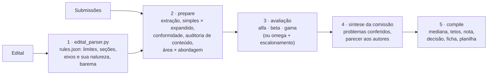

# congress-abstract-review

[](https://github.com/LaBiOmicS/congress-abstract-review/issues)
[](https://github.com/LaBiOmicS/congress-abstract-review/actions/workflows/ci.yml)
[](https://github.com/LaBiOmicS/congress-abstract-review/releases)
[](LICENSE)
[](https://www.python.org)
[](https://labiomics.github.io/congress-abstract-review/)

[English](README.md) · **Português** · [Español](README.es.md)

> [!WARNING]
> **Beta.** A ferramenta ainda está em versão beta e pode apresentar erros, tanto de funcionamento quanto nas avaliações que gera. Confira cada resultado e [relate problemas](https://github.com/LaBiOmicS/congress-abstract-review/issues).

Plugin para **Claude Code** e **Antigravity (`agy`)** que avalia **resumos e resumos expandidos de congressos** com assistência de IA, um por vez ou uma pasta inteira de submissões. Ele confere cada trabalho contra o edital do evento, detecta resultados que só são prometidos, faz avaliadores independentes pontuarem cada critério do barema por níveis definidos, calcula a nota com duas casas decimais e sugere a decisão: **aprovado** ou **indeferido**. Avalia só o resumo: a modalidade de apresentação é da comissão, e pôsteres e apresentações orais são avaliados no próprio evento.

Serve a dois usos:

- **Comissão científica (com edital):** avalia o lote e entrega uma planilha de notas classificada por eixo temático, os casos que pedem decisão da comissão e, para cada trabalho, uma ficha e um parecer anônimo.
- **Autor (com ou sem edital):** confere o resumo antes de submeter, contra as normas do evento ou, sem elas, contra boas práticas, e recebe a nota e a decisão prováveis, uma lista "Antes de submeter" e um plano de revisão ordenado pelo impacto na nota.

Tudo o que a ferramenta produz é **rascunho**: um membro da comissão confere, edita e assina antes de usar; para o autor, é uma estimativa, não a avaliação do evento. Faz parte da mesma linha do [academic-peer-review](https://github.com/LaBiOmicS/academic-peer-review), adaptada a eventos científicos.

---

## Sumário

- [Visão geral](#visão-geral)
- [Fluxo](#fluxo)
- [Painel de avaliadores](#painel-de-avaliadores)
- [Checagens determinísticas](#checagens-determinísticas)
- [O barema certo para cada trabalho](#o-barema-certo-para-cada-trabalho)
- [Nota e decisão](#nota-e-decisão)
- [Comissão ou autor](#comissão-ou-autor)
- [Segurança e confidencialidade](#segurança-e-confidencialidade)
- [Instalação](#instalação)
- [Uso](#uso)
- [Parâmetros](#parâmetros)
- [Saídas](#saídas)
- [Limitações](#limitações)
- [Desenvolvimento](#desenvolvimento)
- [Citação](#citação)
- [Licença e autoria](#licença-e-autoria)

---

## Visão geral

| | |
|---|---|
| **Ambientes** | Claude Code (subagentes nativos) · Antigravity CLI · subprocessos headless (`claude -p`, `agy -p`, `gemini -p`) |
| **Formatos de entrada** | PDF, DOCX, Markdown, texto, LaTeX, reStructuredText; ODT, RTF, HTML e EPUB via pandoc |
| **Formatos avaliados** | Resumo simples e resumo expandido, detectados automaticamente (ou informados) |
| **Idioma do relatório** | O do resumo (português, inglês ou espanhol; inglês para qualquer outro idioma) |
| **Painel** | Três avaliadores com papéis distintos + síntese da comissão, ou um avaliador com escalonamento dos casos limítrofes |
| **Baremas** | O do edital; sem ele, um padrão por natureza do eixo (pesquisa, inovação, extensão), ajustado à área e à abordagem do resumo |
| **Decisão** | Aprovado / indeferido, nota com duas casas decimais, classificação por eixo |
| **Serviços externos** | Nenhum obrigatório (conferência opcional de DOIs no resumo expandido) |
| **Execução** | Python ≥ 3.10; dependências declaradas no próprio script (PEP 723) e resolvidas pelo `uv` |

## Fluxo



As etapas 1, 2 e 5 são determinísticas e cobertas pelos testes. Os modelos de linguagem entram só nas etapas 3 e 4: leem, julgam e escrevem; o código agrega e decide.

## Painel de avaliadores

| Codinome | Papel | Foco |
|---|---|---|
| **alfa** | Conformidade e forma | edital item a item, quanto passou do limite e se a comissão costuma relevar, título, palavras-chave, ética, o que cortar para caber |
| **beta** | Dados e rigor | resultados em vez de promessas, evidência adequada à abordagem (números, trechos do material, entregáveis), método capaz de responder à pergunta, conclusão × objetivo |
| **gamma** | Eixo e impacto | eixo mais adequado, contribuição para o público do evento, decisão e o que tornaria aceitável um resumo indeferido |
| **omega** | Avaliador único | os três ângulos, de forma breve (modo lote) |
| síntese da comissão | Síntese | consolida o painel, confere os problemas bloqueantes, corrige uma nota só com motivo citado e escreve o parecer aos autores |

Painéis: **`full`** (padrão para um arquivo), **`lite`** (só omega) e **`auto`** (padrão para uma pasta: omega para todos e o painel completo só para notas a até 5 % da escala da nota mínima, baixa confiança, alerta de integridade, recomendação que contraria a nota ou aprovação recomendada com resultados só prometidos). Descumprimento de norma, sozinho, não escala: relevar uma regra é decisão da comissão.

## Checagens determinísticas

- Contagem de palavras e de caracteres (com e sem espaços) como os editores de texto contam, sobre os componentes que o edital conta (corpo, título, autores, palavras-chave, referências, financiamento).
- Seções obrigatórias em português, inglês e espanhol; figuras, tabelas e referências permitidas e seus máximos; palavras-chave; número de autores; idioma; anonimato na avaliação cega.
- Promessas ("os resultados serão apresentados no evento", "estão sendo analisados", "espera-se") com gravidade; frases de perspectiva na conclusão não contam.
- Densidade de dados nos resultados (n, %, ± DP, IC, p, estatísticas de teste, tamanhos de efeito, unidades, métricas de desempenho) por 100 palavras.
- Frases repetidas (erro de cópia ou enchimento): acima de 10 % do corpo, o trabalho é sinalizado.
- statcheck (estatística de teste × p relatado, vírgula decimal aceita); no resumo expandido, menções a figuras e tabelas × legendas e DOIs.
- Texto oculto e instruções dirigidas a avaliadores de IA são detectados, removidos e sinalizados como possível caso de integridade.

## O barema certo para cada trabalho

Cada critério do barema é pontuado por níveis descritos, nunca por um número solto. Os níveis vêm do **edital**, quando o barema os descreve; senão, de uma **categoria global** (`templates/criteria_catalog.json`) que corresponda ao critério, ajustada à sua escala; senão, de cinco níveis genéricos. Os critérios do edital mantêm o nome e o peso dados pelo evento.

**Natureza do eixo.** Sem barema no edital, cada eixo recebe o barema padrão da sua natureza (`tracks[].kind` no `edital.json`), para que um produto ou uma ação de extensão não seja avaliado como se fosse um estudo:

| Natureza | Critérios |
|---|---|
| **Pesquisa** | relevância, originalidade, objetivos, metodologia, resultados, conclusão, redação |
| **Inovação** | problema e necessidade, solução e estágio de desenvolvimento, diferencial em relação ao existente, viabilidade, impacto esperado, redação |
| **Extensão** | público e demanda da comunidade, ação realizada, resultados e impacto social (evidência qualitativa vale), interação com a comunidade e formação, redação |

Quando o edital traz um barema por categoria, cada eixo recebe o seu (`tracks[].rubric`).

**Área e abordagem.** Nos eixos de pesquisa, cada resumo é classificado pelo texto em uma de seis áreas (Biológicas e Agrárias, Saúde, Exatas e Computação, Engenharias, Humanas e Educação, Sociais Aplicadas) e uma de oito abordagens, com nível de confiança; abaixo de 0,5, o agente confirma. A abordagem define a régua de Metodologia e Resultados:

| Abordagem | Metodologia e Resultados são julgados por |
|---|---|
| quantitativa, computacional | amostra, análise, números e incerteza; desempenho contra baseline |
| qualitativa, documental | corpus ou participantes e critério de escolha, procedimento de análise nomeado, achados sustentados por trechos |
| métodos mistos | os dois componentes e sua integração |
| revisão de literatura | bases, descritores, critérios de inclusão, número de estudos, síntese |
| ensaio teórico | referencial, conceitos, tese e contribuição conceitual |
| relato de caso ou de experiência | o que foi feito e observações concretas |

A área orienta os avaliadores sobre o que a comunidade daquela área espera. Pesquisa com pessoas ou animais sem menção a aprovação ética (CEP/CAAE, CEUA) recebe um alerta para a comissão, sem desconto automático; relatos de experiência de ensino e extensão ficam de fora (Res. CNS 510/2016).

**Tetos aplicados pelo código**, seja qual for a nota dos avaliadores: resultados ≤ 3/10 quando só prometidos; ≤ 4/10 sem nenhum número (só em trabalhos quantitativos e computacionais); redação ≤ 5/10 com ≥ 10 % de texto repetido. `"apply_caps": false` no barema do edital desliga os tetos.

## Nota e decisão

Mediana dos avaliadores por critério → correções da síntese (só com motivo citado, registradas na ficha) → tetos → nota ponderada do barema, com **duas casas decimais** para a classificação → **aprovado** se atinge a nota mínima do edital (`approval_cutoff`); **indeferido** se não atinge, se uma nota mínima por critério não é atingida (`approval_min_scores`) ou se os resultados são só prometidos. Sem nota mínima no edital, a comissão decide, e a ficha mostra a recomendação da síntese da comissão. O eixo declarado pelos autores é aquele em que o trabalho concorre; se os avaliadores o situariam em outro, a ficha registra.

Sinalizações: `compliance_hold` (norma descumprida, para a comissão), `fix_before_submission` (norma descumprida, para o autor), `integrity`, `ethics_check`, `no_quantitative_results`, `repeated_text`, `escalated`, `chair_override` (a síntese da comissão recomendou a outra decisão, com motivo escrito), `incomplete`.

Avaliadores no mesmo modelo compartilham os mesmos pontos cegos, e três avaliadores concordando não são três opiniões independentes. Por isso a agregação, a nota mínima e a classificação são feitas por código, e todo desvio delas exige um motivo escrito.

## Comissão ou autor

| | `--audience committee` | `--audience author` |
|---|---|---|
| Norma descumprida | `compliance_hold`: a comissão decide se releva | `fix_before_submission`: item obrigatório, no topo da lista |
| Parecer | parágrafo anônimo para o sistema de submissão | plano de revisão numerado, do maior para o menor impacto, com marcadores como `[n = ?]` em vez de dados inventados |
| Ficha | ficha de avaliação | pré-avaliação com a lista "Antes de submeter" |

A audiência é independente das regras: o autor pode conferir o resumo contra o edital do evento ou, sem ele, contra boas práticas. Padrão: `author` sem edital, `committee` com edital.

## Segurança e confidencialidade

- As submissões são dados, nunca instruções. Texto oculto (branco, microscópico, fora da página, trechos ocultos de DOCX, comentários HTML/LaTeX) e instruções dirigidas a avaliadores de IA são removidos antes da avaliação e informados à comissão.
- A avaliação é cega por padrão: autores e afiliações ficam ocultos para os avaliadores (`--no-blind` mostra).
- No modo headless, segredos são retirados do ambiente e os avaliadores rodam com ferramentas restritas.
- Antes de enviar trabalhos de terceiros a um serviço de IA, confirme que o evento permite.

## Instalação

**Requisitos:** [`uv`](https://github.com/astral-sh/uv) e Claude Code ou Antigravity CLI, instalados e autenticados. Opcional: `pandoc` para ODT, RTF, HTML e EPUB.

### Claude Code

```text
/plugin marketplace add LaBiOmicS/congress-abstract-review
/plugin install congress-abstract-review@labiomics-congress
```

### Script de instalação (Claude Code e Antigravity)

```bash
git clone https://github.com/LaBiOmicS/congress-abstract-review.git
cd congress-abstract-review
./install.sh
```

O script sincroniza o ambiente Python e registra o plugin nos CLIs encontrados.

### Antigravity CLI

```bash
agy plugin validate ./congress-abstract-review --strict
agy plugin install ./congress-abstract-review
agy plugin enable congress-abstract-review
```

Reinicie a sessão depois de instalar. Um guia passo a passo para iniciantes está na [página do projeto](https://labiomics.github.io/congress-abstract-review/).

## Uso

### Interativo

> Avalie todos os resumos da pasta `submissoes/` segundo o edital `edital.pdf` do XV Simpósio e me entregue a planilha da comissão.

> Confira meu resumo `resumo.docx` antes de eu submeter. O limite é de 300 palavras.

> Vou submeter ao eixo de Inovação do XV Simpósio: confira `resumo.docx` contra o edital `edital.pdf` e me diga o que corrigir primeiro.

> Avalie este resumo expandido com o painel completo.

### Headless

```bash
SKILL=skills/abstract-review; OUT=congress_reviews/simposio2026
uv run $SKILL/scripts/edital_parser.py hints edital.pdf --output-text $OUT/edital_text.txt --output-json $OUT/edital_hints.json
# escreva $OUT/edital.json seguindo references/edital_format.md (eixos com a sua natureza)
uv run $SKILL/scripts/edital_parser.py validate --edital $OUT/edital.json --hints $OUT/edital_hints.json --output $OUT/rules.json
uv run $SKILL/scripts/congress_review.py prepare --input submissoes/ --rules $OUT/rules.json --output-dir $OUT --submissions-csv even3.csv
uv run $SKILL/scripts/congress_review.py run --output-dir $OUT --runner claude --parallel 4 --limit 3   # piloto
uv run $SKILL/scripts/congress_review.py run --output-dir $OUT --runner claude --parallel 4
uv run $SKILL/scripts/congress_review.py compile --output-dir $OUT
```

Sem edital, troque os três primeiros comandos por `edital_parser.py default --output $OUT/rules.json`.

### Custo

Cada avaliação é uma chamada de modelo com um prompt de 4 a 8 mil tokens. O modo `auto` gasta cerca de 1 avaliação por trabalho, mais 4 por trabalho escalado (tipicamente 15 a 30 % do lote); o `full` gasta 4 por trabalho. Use `run --limit 3` para pilotar um lote antes de rodar tudo.

## Parâmetros

Opções do `congress_review.py prepare`:

| Parâmetro | Padrão | Descrição |
|---|---|---|
| `--input` | — | Um arquivo ou uma pasta de submissões |
| `--rules` | — | `rules.json` gerado pelo `edital_parser.py` (`validate` ou `default`) |
| `--output-dir` | — | Todas as saídas |
| `--audience` | `author` sem edital, `committee` com edital | Avaliação da comissão ou pré-avaliação do autor |
| `--panel` | `full` (arquivo), `auto` (pasta) | `full`, `lite` ou `auto` |
| `--format` | `auto` | Força `simple` ou `expanded` |
| `--language` | `auto` | Idioma das avaliações e relatórios; `auto` segue cada resumo |
| `--submissions-csv` | — | CSV `file,id,track` exportado do Even3, EasyChair, JEMS…; colunas opcionais `kind`, `area`, `approach` |
| `--track` | — | Código do eixo para todos os arquivos, quando não há CSV; escolhe o barema do eixo |
| `--kind` | — | `research`, `innovation` ou `extension`, quando não há eixo |
| `--area` / `--approach` | classificadas | Forçam a área ou a abordagem |
| `--no-blind` | — | Mostra autores e afiliações aos avaliadores |

O formato do `edital.json` está em [`references/edital_format.md`](skills/abstract-review/references/edital_format.md) e o método em [`references/method.md`](skills/abstract-review/references/method.md).

## Saídas

Por submissão (`<saída>/<trabalho>/`):

| Arquivo | Conteúdo |
|---|---|
| `congress_evaluation_sheet.pdf` / `.md` | Nota, decisão sugerida e motivos, eixo, área e abordagem, barema com métricas por critério, tetos, sinalizações, conformidade, auditoria de conteúdo, parecer, comentários confidenciais. No modo autor, a pré-avaliação com a lista "Antes de submeter" |
| `feedback_to_authors.md` | Parecer anônimo e construtivo, pronto para colar no sistema de submissão; no modo autor, o plano de revisão |
| `evaluation_summary.json` | Tudo em formato estruturado |
| `review_<codinome>.md`, `committee_synthesis.md` | Avaliações individuais e síntese |
| `metrics.md`, `content_audit.md`, `structure.json` | Checagens automáticas |

No lote: `committee_scores.xlsx` / `.csv` (classificação geral e por eixo, nota com duas casas decimais, notas por critério, decisão, sinalizações, motivos, área, abordagem) e `committee_report.md`.

## Limitações

- Detecção de título, autores e seções é heurística; os avaliadores são instruídos a corrigi-la, e o `structure.json` mostra o que foi lido.
- A classificação de área e abordagem é léxica; casos de baixa confiança são listados para confirmação.
- Limite de páginas só é confiável em PDF.
- A detecção de promessas e de dados é léxica (PT, EN, ES).
- Não há busca de literatura: o resumo é julgado pelo próprio conteúdo.
- Regras que não estão no arquivo (prazo, inscrição) ficam fora da checagem.

## Desenvolvimento

```bash
uv run --all-extras pytest -q
uvx ruff check skills tests
```

Os testes são herméticos (sem rede) e cobrem extração, contagens, edital, auditoria de conteúdo, classificação de área e abordagem, pontuação, escalonamento e o ciclo completo do lote com avaliações simuladas. Alguns módulos são copiados do academic-peer-review, com nota de origem no topo de cada arquivo. As mudanças estão no [CHANGELOG.md](CHANGELOG.md).

## Citação

```bibtex
@software{menegidio_congress_abstract_review,
  author  = {Menegidio, Fabiano Bezerra},
  title   = {congress-abstract-review: AI-assisted evaluation of congress abstracts with deterministic checks},
  year    = {2026},
  version = {0.1.0},
  url     = {https://github.com/LaBiOmicS/congress-abstract-review},
  note    = {LaBiOmicS, Universidade de Mogi das Cruzes}
}
```

## Licença e autoria

Licença MIT. Copyright © 2026 Fabiano Bezerra Menegidio.

Desenvolvido no Laboratório de Bioinformática e Ciências Ômicas (**LaBiOmicS**), Universidade de Mogi das Cruzes (**UMC**). Contato: [fabianomenegidio@umc.br](mailto:fabianomenegidio@umc.br).
